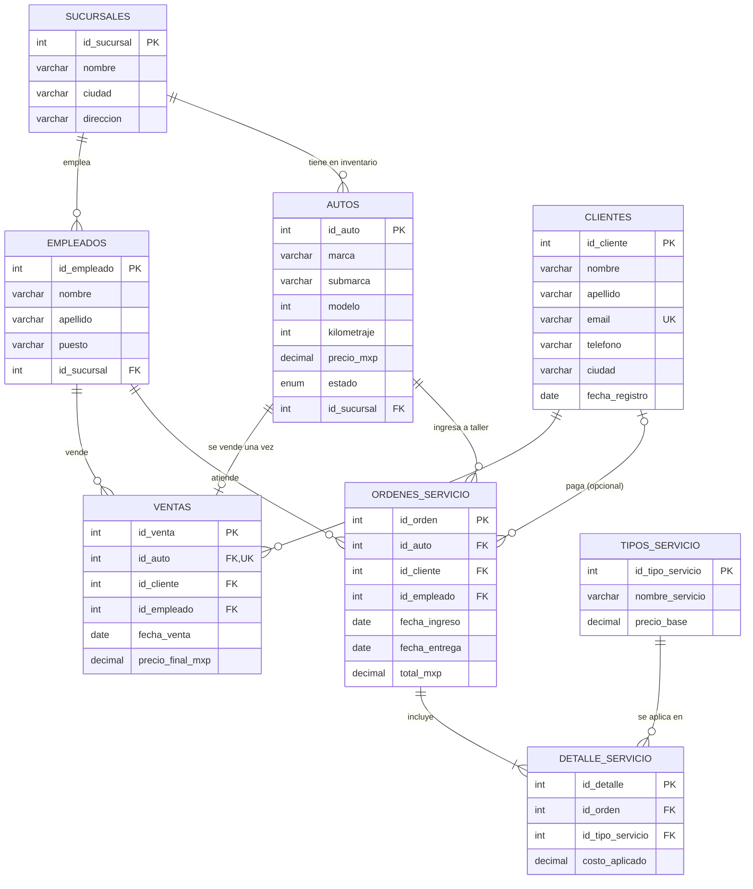

# Base de datos `agencia`: estructura de los seeds

Base de datos de una agencia de autos con venta de vehículos y taller de servicio, con datos sintéticos. Sirve como fuente para practicar un sistema web (Laravel + Vue con TypeScript) y un pipeline ETL.

MySQL ejecuta estos scripts en orden alfabético, solo la primera vez que se crea el volumen de datos:

| Orden | Archivo | Qué hace |
| --- | --- | --- |
| 1 | [`01_seed.sql`](01_seed.sql) | Crea la base `agencia` y las 8 tablas (borra las existentes) y carga un conjunto pequeño, escrito a mano |
| 2 | [`02_seed_masivo.sql`](02_seed_masivo.sql) | Agrega volumen: 2,000 ventas y 4,000 órdenes de servicio, más datos en las demás tablas |

`02` depende de `01` (usa sus tablas y sus ids). Requiere MySQL 8.0 o superior, porque usa CTEs recursivas y funciones de ventana.

> Docker ignora este `README.md` al inicializar (solo ejecuta `.sql`, `.sh` y variantes comprimidas) y lo registra en el log como "ignoring".

## Diagrama entidad-relación



## Tablas

Todas las llaves primarias son `INT AUTO_INCREMENT`. Todas las llaves foráneas aceptan `NULL`, y ninguna define `ON DELETE` ni `ON UPDATE` (el comportamiento por defecto es rechazar el borrado de un registro con hijos). Charset `utf8mb4`, collation `utf8mb4_unicode_ci`.

### `sucursales`

| Columna | Tipo | Restricciones |
| --- | --- | --- |
| `id_sucursal` | INT | PK |
| `nombre` | VARCHAR(100) | NOT NULL |
| `ciudad` | VARCHAR(50) | NOT NULL |
| `direccion` | VARCHAR(150) | NOT NULL |

### `clientes`

| Columna | Tipo | Restricciones |
| --- | --- | --- |
| `id_cliente` | INT | PK |
| `nombre` | VARCHAR(50) | NOT NULL |
| `apellido` | VARCHAR(50) | NOT NULL |
| `email` | VARCHAR(100) | NOT NULL, UNIQUE |
| `telefono` | VARCHAR(15) | |
| `ciudad` | VARCHAR(50) | |
| `fecha_registro` | DATE | Por defecto `2023-01-01` |

### `empleados`

| Columna | Tipo | Restricciones |
| --- | --- | --- |
| `id_empleado` | INT | PK |
| `nombre` | VARCHAR(50) | NOT NULL |
| `apellido` | VARCHAR(50) | NOT NULL |
| `puesto` | VARCHAR(50) | NOT NULL. Valores usados: `Vendedor`, `Gerente`, `Asesor de Servicio`, `Mecánico` |
| `id_sucursal` | INT | FK → `sucursales` |

### `autos`

| Columna | Tipo | Restricciones |
| --- | --- | --- |
| `id_auto` | INT | PK |
| `marca` | VARCHAR(50) | NOT NULL |
| `submarca` | VARCHAR(50) | NOT NULL |
| `modelo` | INT | NOT NULL (año del modelo) |
| `kilometraje` | INT | NOT NULL |
| `precio_mxp` | DECIMAL(12,2) | NOT NULL (precio de lista) |
| `estado` | ENUM | `'Nuevo'`, `'Usado'`, `'Vendido'`. Por defecto `'Nuevo'` |
| `id_sucursal` | INT | FK → `sucursales` |

### `ventas`

| Columna | Tipo | Restricciones |
| --- | --- | --- |
| `id_venta` | INT | PK |
| `id_auto` | INT | FK → `autos`, UNIQUE (un auto se vende una sola vez) |
| `id_cliente` | INT | FK → `clientes` |
| `id_empleado` | INT | FK → `empleados` |
| `fecha_venta` | DATE | NOT NULL |
| `precio_final_mxp` | DECIMAL(12,2) | NOT NULL |

### `tipos_servicio`

| Columna | Tipo | Restricciones |
| --- | --- | --- |
| `id_tipo_servicio` | INT | PK |
| `nombre_servicio` | VARCHAR(100) | NOT NULL |
| `precio_base` | DECIMAL(10,2) | NOT NULL |

### `ordenes_servicio`

| Columna | Tipo | Restricciones |
| --- | --- | --- |
| `id_orden` | INT | PK |
| `id_auto` | INT | FK → `autos` |
| `id_cliente` | INT | FK → `clientes`. `NULL` cuando el auto es de la agencia |
| `id_empleado` | INT | FK → `empleados` |
| `fecha_ingreso` | DATE | NOT NULL |
| `fecha_entrega` | DATE | |
| `total_mxp` | DECIMAL(10,2) | NOT NULL |

### `detalle_servicio`

| Columna | Tipo | Restricciones |
| --- | --- | --- |
| `id_detalle` | INT | PK |
| `id_orden` | INT | FK → `ordenes_servicio` |
| `id_tipo_servicio` | INT | FK → `tipos_servicio` |
| `costo_aplicado` | DECIMAL(10,2) | NOT NULL (puede diferir del `precio_base`) |

## Volumen de datos

| Tabla | `01_seed.sql` | `02_seed_masivo.sql` agrega | Total |
| --- | ---: | ---: | ---: |
| `sucursales` | 3 | 3 | 6 |
| `empleados` | 5 | 35 | 40 |
| `clientes` | 12 | 1,451 | 1,463 |
| `autos` | 17 | 2,400 (2,000 vendidos y 400 en inventario) | 2,417 |
| `ventas` | 12 | 2,000 | 2,012 |
| `tipos_servicio` | 7 | 13 | 20 |
| `ordenes_servicio` | 8 | 4,000 | 4,008 |
| `detalle_servicio` | 11 | 6,359 | 6,370 |

Los rangos de ids de cada seed son contiguos: por ejemplo, las ventas de `01` van del 1 al 12 y las de `02` del 13 al 2012.

## Qué contiene `01_seed.sql`

Un conjunto pequeño y legible, útil para entender el modelo y probar consultas a mano:

- 3 sucursales (Ciudad de México, Guadalajara, Monterrey).
- 12 ventas entre enero y junio de 2024, y 8 órdenes de servicio en el mismo periodo.
- Clientes registrados entre noviembre de 2023 y mayo de 2024.
- Tres órdenes sin cliente (`id_cliente` en `NULL`).
- Declara `SET NAMES utf8mb4;` al inicio. Sin esa línea, el cliente `mysql` de la imagen oficial lee el archivo como `latin1` y los acentos se guardan mal.

## Qué contiene `02_seed_masivo.sql`

Genera datos pseudoaleatorios pero **deterministas**: usa `CRC32` sobre un texto fijo en lugar de `RAND()`, así que cada ejecución produce exactamente los mismos datos. Los parámetros están al inicio del archivo y se pueden cambiar:

| Parámetro | Valor | Efecto |
| --- | --- | --- |
| `@n_ventas` | 2000 | Ventas nuevas (cada una con su auto vendido) |
| `@n_ordenes` | 4000 | Órdenes de servicio nuevas |
| `@n_inventario` | 400 | Autos en inventario, sin vender |
| `@fecha_inicio` | 2022-01-01 | Inicio del periodo de ventas |
| `@fecha_corte` | 2024-06-30 | Ningún dato posterior a esta fecha |

Para generar los datos usa tablas auxiliares con prefijo `_` (`_seq`, `_nombres`, `_apellidos`, `_catalogo`, `_plan_ventas`, `_plan_ordenes`), que elimina al terminar.

### Reglas de generación

| Tabla | Regla |
| --- | --- |
| `sucursales` | Agrega Puebla, Querétaro y Tijuana (ids 4 a 6) |
| `empleados` | Por sucursal: 2 vendedores, 1 asesor de servicio y 2 mecánicos. Agrega un gerente donde no hay |
| `clientes` | Un cliente por cada primera compra. Se registra de 0 a 20 días antes de comprar. Email `clienteNNNNN@example.com`. La ciudad es la de la sucursal donde compra. El teléfono lleva lada de la ciudad |
| `autos` | Catálogo de 30 modelos con precio base; los primeros se eligen con más frecuencia. En los vendidos, 60 % son nuevos (0 km) y 40 % usados de 1 a 8 años. El precio base (referencia 2024) baja 4 % por cada año que la venta es anterior a 2024, y otro 8 % por cada año de uso del auto. Inventario: 55 % nuevos y el resto usados de 1 a 6 años |
| `ventas` | Fechas distribuidas en 912 días (2022-01-01 a 2024-06-30), con un auto por venta. El vendedor es de la sucursal del auto. El precio final es de 94 % a 100 % del precio de lista. Cerca del 72 % de las ventas son de clientes nuevos y el resto son clientes recurrentes (381 clientes compran más de una vez) |
| `ordenes_servicio` | 8 % son revisiones previas a la venta (1 a 10 días antes, sin cliente), 85 % son servicios posteriores a la venta a nombre del comprador, y 7 % son servicios a autos del inventario (sin cliente, en los últimos 182 días). Los autos vendidos hace más tiempo reciben más servicios. La entrega es de 0 a 3 días después del ingreso. La atiende un asesor o mecánico de la sucursal del auto |
| `detalle_servicio` | 1 servicio por orden (55 %), 2 (30 %) o 3 (15 %), sin repetir tipo en la misma orden. La elección favorece los tipos con id bajo (el cambio de aceite es el más común). El segundo y tercer servicio de una orden se desplazan 7 tipos en el catálogo, por eso la "Afinación mayor" (id 8) también es frecuente. Cerca del 10 % de las líneas tiene 10 % de descuento sobre `precio_base` |
| `ordenes_servicio.total_mxp` | Se calcula como la suma de `costo_aplicado` de sus detalles |

## Reglas que se cumplen

Se comprobaron con consultas sobre la base cargada con ambos seeds:

- Cada orden tiene al menos un detalle, y `total_mxp` es igual a la suma de sus detalles (incluidas las 8 órdenes de `01`).
- Ningún cliente compra antes de su `fecha_registro`.
- Todo auto en estado `Vendido` tiene una venta, y toda venta es de un auto `Vendido`.
- No hay fechas posteriores a `2024-06-30`, ni `fecha_entrega` anterior a `fecha_ingreso`.
- No hay emails duplicados ni precios en cero o negativos.
- Los 20 tipos de servicio se usan al menos una vez.

## Particularidades a tener en cuenta

Estos puntos importan al diseñar el sistema y el pipeline:

- **Los ids no siguen el orden cronológico.** Las 12 ventas de `01` son de 2024 y tienen los ids 1 a 12, mientras que las de `02` empiezan en 2022 con el id 13. Para análisis temporales, ordena por fecha y no por id.
- **Hay órdenes anteriores a 2022.** Las revisiones previas a la venta pueden caer antes de `@fecha_inicio` (la fecha mínima es 2021-12-23).
- **`ordenes_servicio.id_cliente` es `NULL` en 619 de 4,008 órdenes** (revisiones previas e inventario). Un `JOIN` interno con `clientes` las descarta, y ese es un buen caso para practicar.
- **Datos de `01` inconsistentes con la sucursal.** Las ventas 3, 4, 8 y 11 y las órdenes 4, 5 y 8 tienen un empleado de una sucursal distinta a la del auto. Los datos de `02` no tienen este problema.
- **Los datos son limpios.** No hay duplicados, nulos inesperados, valores atípicos ni errores de formato. Para practicar limpieza y validación en el ETL, conviene ensuciarlos aparte (por ejemplo, en un script de ruido sobre una copia) y no editar los seeds.
- **No hay columnas de auditoría** (`created_at`, `updated_at`). Una extracción incremental solo puede apoyarse en `fecha_venta`, `fecha_ingreso` y `fecha_registro`, y no detecta cambios en registros ya cargados.
- **Los nombres no siguen las convenciones de Laravel.** Las tablas están en español y las llaves primarias se llaman `id_<tabla>`. En cada modelo de Eloquent hay que definir `$table` y `$primaryKey`, y `$timestamps = false` porque no existen `created_at` ni `updated_at`.
- **`estado` en `autos` es un ENUM de MySQL.** En TypeScript se representa como el tipo unión `'Nuevo' | 'Usado' | 'Vendido'`. Los campos `DECIMAL` llegan como cadena en JSON desde Laravel, así que conviene convertirlos a número en el frontend.

## Cargar los datos

**Base nueva** (volumen vacío): Docker ejecuta ambos scripts solo. Ver [Base de datos MySQL con Docker](../README.md#base-de-datos-mysql-con-docker).

**Contenedor ya inicializado:** el volumen conserva los datos y Docker no vuelve a ejecutar los scripts. `01_seed.sql` borra y recrea las tablas, así que se pierde lo que haya en `agencia`:

```bash
docker exec -i ds-mysql sh -c 'mysql -uroot -p"$MYSQL_ROOT_PASSWORD" --default-character-set=utf8mb4' < init/01_seed.sql
docker exec -i ds-mysql sh -c 'mysql -uroot -p"$MYSQL_ROOT_PASSWORD" --default-character-set=utf8mb4' < init/02_seed_masivo.sql
```

Si ejecutas `02` dos veces seguidas, falla en el primer `INSERT` (llave duplicada en `sucursales`) y no agrega nada. Para repetirlo, ejecuta `01` antes.

**Verificar el resultado:**

```bash
docker exec ds-mysql sh -c 'mysql -uroot -p"$MYSQL_ROOT_PASSWORD" agencia -e "SELECT COUNT(*) AS ventas FROM ventas; SELECT COUNT(*) AS ordenes FROM ordenes_servicio;"'
```

Debe mostrar 2,012 ventas y 4,008 órdenes.
