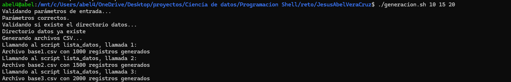
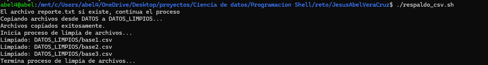
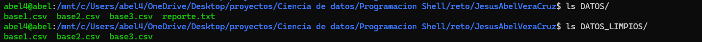
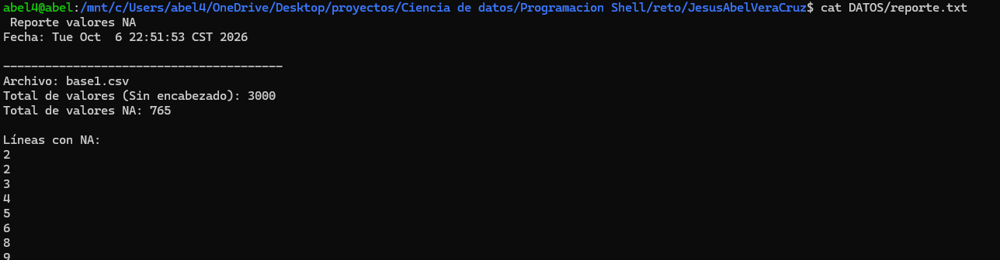
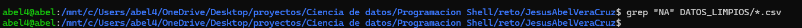

#  Programación Shell de linuz en Ciencia de datos 

**Autor:** Jesus Abel Vera Cruz 
**Fecha:** 06-10-2026
**Módulo:** Programación Shell de Linux en ciencia de datos

#### Hardware: Intel(R) Core(TM) i7-10700T CPU @ 2.00GHz (1.99 GHz) 32.0 GB RAM, 932 GB SD
#### Software: Windows 11 Home Single Language Versión 26H2

##  Descripción del Reto
Este es un documento donde se describen a detalle los pasos realizados para la programación del reto correspondiente al curso de **Programación Shell de linuz en Ciencia de datos de datos.**.

### Instalaciones previas (Sólo aplica para windows)
Se instalo WSL para poder trabajar con el shell de linux se llevo a cabo la instalación con ayuda de este manual
>Manual de instalación WSL https://learn.microsoft.com/es-es/windows/wsl/install

Este proyecto consiste en 4 scripts de Bash en conjunto para:

1. **Generar** archivos csv con datos aletarios y valores nulos (NA)
2. **Coordinar** la generacion de 3 archivos
3. **Buscar** valores nulos y generar reporte
4. **Limpiar y respaldar** los archivos cambiando NA por 0

## Estructura

El proyecto esta en un archivo .zip llamado JesusAbelVeraCruz.zip en el cual contiene los 4 sh que se usan en el proyecto un archivo README.md (es este) y 5 imagenes
que se usan para la demostración de la ejecución del proyecto

**lista_datos.sh**: Genera filas de datos aleatorios, 
**generacion.sh**:Coordina la generación de CSV, 
**busqueda_na.sh**: Busca NA y genera reporte.txt, 
**respaldo_csv.sh**:Respaldar y limpiar los csv


## Ejecutar el proyecto

Dar permisos de ejecucion a todos los .sh dentro de la carptea con el comando ```chmod +x *.sh```

### Ejecutar en el siguiente orden

Aqui se muestra como eejcutar los scripts y su correspondiente salida en img de la consola.

#### 1.- Generación de archivos csv
```./generacion.sh 10 15 20``` (los parámetros deben ser diferentes y estar entre 10 y 20)



#### 2.- Buscar valores NA
```./busqueda_na.sh```


#### 3.- Respaldar y limpiar los csv
```./respaldo_csv.sh```



#### Verificar archivos generados
```ls DATOS/```
```ls DATOS_LIMPIOS/```



#### Ver reporte 
```cat DATOS/reporte.txt```



#### Verificar que ya no hay NA en los csv
```grep "NA" DATOS_LIMPIOS/*.csv```

