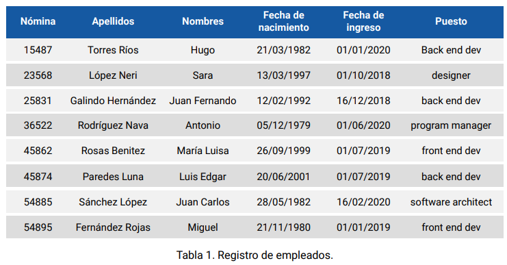
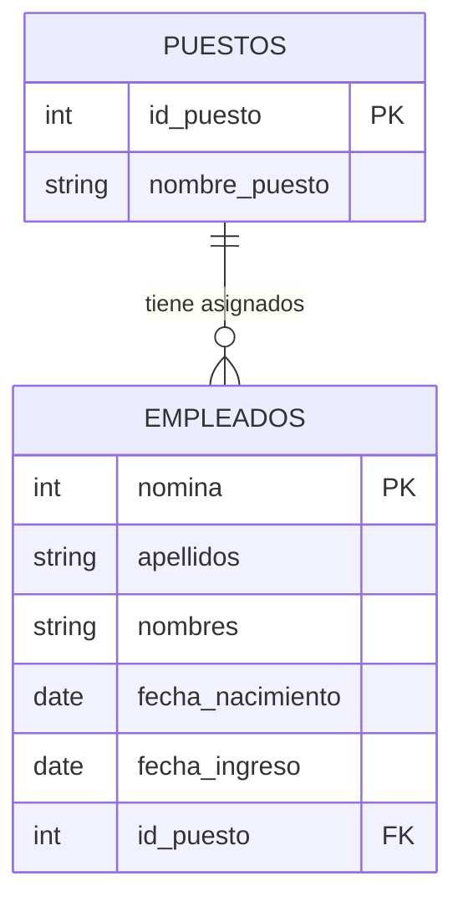

# Subcompetencia 1

## Procesamiento e integración de datos 

### Bases de datos

En este curso se ve los elementos básicos de las bases de datos relacionales y el modelo entidad relación que son los siguientes:

1. Atributo: Característica que defina una entidad.
2. Entidad: Objeto o concepto del mundo real que se representa en la base de datos.
3. Tuplas: conjunto de valores con cierto orden, donde cada uno de estos valores está en un dominio determinado.
4. Dominio: Conjuntos de posibles valores atómicos asociados a un atributo, es decir, valores no divisibles.
5. Relación: Tabla bidimensional, con filas y columnas, donde cada fila represetna una entidad y cada columna un atributo, es decir, una característica de la entidad.
6. Base de datos relacional: Colección de relaciones (tablas) en las que existen algunos vínculos entre ellas.

En la tabla que se muestra a continuación hay 8 registrosm cada uno con 6 atributos de diferentes tipos de datos.

Ejemplo de tabla:


En una tabla no podemos tener dos elementos iguales, de la misma forma que en la teoría de conjuntos no existen dos elementos iguales dentro de un conjunto.

#### LLave primaria

El concepto de llave primaria permite no tener dos registros iguales dentro de una tabla
por que lo que hace es identificar de manera única a todo el registro de la tabla generalmente es un valor numérico incremental pero también puede ser un hash único.

En el caso de la tabla de empleados la llave primaria es el atributo nómina por que asigna un valor único a cada empleado, evitando que existan registros duplicados.

En cuantoa a la terminología, podemos definir el *dominio asociado a cada atributo*
que es el conjuntos de posibles valores que puede tomar ese atributo de una tupla,
frecuentemente identificado como tipo de dato del atributo.

- El atribuuto nómina es un número de 5 dígitos
- El atributo apellidos y nombre es una cadena de caracteres de cierta longitud
- El atributo fecha de nacimiento es una fecha en formato día/mes/año
- El atributo puesto es un cadade de caracteres de cierta longitud


El grado de la tabla es el numero de atributos o columnas que posee, en este caso la tabla tiene 6 atributos.

El cardinalidad de la tabla es el numero de registros o filas que posee, en este caso la tabla tiene 8 registros.

#### Llave foránea

Una llave foránea es un atributo o conjunto de atributos en una tabla que hace referencia a la llave primaria de otra tabla, estableciendo un vínculo entre ambas tablas.
Por ejemplo en el ejemplo de los empleados podemos pensar en una tabla de puestos donde se asigne un id o una clave a cada puesto y en la tabla empleados en lugar de guardar el texto del puesto se guarda el id correspondiente, estableciendo así un vínculo entre ambas tablas.



Un puesto puede estar asignado a muchos empleados, pero cada empleado tiene un único puesto (relación uno a muchos). El atributo `id_puesto` en `EMPLEADOS` es la llave foránea que referencia la llave primaria de `PUESTOS`.


#### Base de datos no relacionales

Las bases de datos no relacionales, comúnmente llamdas bases de datos NoSQl, se fierencian de las tradicionales (relacionales) en que no siempre almancena sus datos en forma tabular.

Por otro lado, las bases de datos no relacionales pueden basar su construcción
en algunas estructuras de datos, como, por ejemplo, los documentos. En el caso
de una empresa, la información de clientes podría estar en documentos de diferentes formatos, que no necesariamente pueden almacenarse en forma de una
tabla; podrían contener información sobre los productos que compran, así como
su teléfono, dirección, etc., y los datos a almacenar de cada cliente podrían ser
distintos.
Uno de los tipos de base de datos NoSQL son las bases de datos basadas en
documentos. Una base de datos de documentos o base de datos documental
está formada por documentos que tienen la estructura de un archivo JSON o
XML.

### Álgebra relacional

El álgebra relacional es un conjunto de operaciones que permiten consultar y combinar relaciones. Cada operación recibe una o más relaciones y produce otra relación, por lo que sus resultados pueden utilizarse en operaciones posteriores. Estas ideas son la base de las consultas en bases de datos relacionales.

Algunas operaciones fundamentales son:

| Operación | Notación | Descripción |
| --- | --- | --- |
| Selección | $\sigma_{\text{condición}}(R)$ | Filtra las filas de `R` que cumplen una condición. |
| Proyección | $\pi_{\text{atributos}}(R)$ | Selecciona determinados atributos o columnas de `R`. |
| Unión | $R \cup S$ | Reúne las tuplas que aparecen en `R`, en `S` o en ambas. |
| Intersección | $R \cap S$ | Obtiene las tuplas que aparecen tanto en `R` como en `S`. |
| Diferencia | $R - S$ | Obtiene las tuplas de `R` que no aparecen en `S`. |
| Producto cartesiano | $R \times S$ | Combina cada tupla de `R` con cada tupla de `S`. |
| Renombramiento | $\rho_{\text{nuevo nombre}}(R)$ | Cambia el nombre de una relación o de sus atributos. |
| Reunión o *join* | $R \bowtie_{\text{condición}} S$ | Combina tuplas de dos relaciones que cumplen una condición. |

Para aplicar unión, intersección o diferencia, las relaciones deben ser compatibles: tener el mismo número de atributos y dominios correspondientes compatibles. En el modelo relacional las relaciones son conjuntos, por lo que no contienen tuplas duplicadas. En cambio, SQL y pandas pueden conservar filas duplicadas.

Por ejemplo, con las tablas `EMPLEADOS` y `PUESTOS` del diagrama:

- Selección: $\sigma_{\text{id_puesto}=1}(\text{EMPLEADOS})$ obtiene los empleados cuyo puesto tiene identificador 1.
- Proyección: $\pi_{\text{nomina},\text{nombres}}(\text{EMPLEADOS})$ obtiene las columnas `nomina` y `nombres`.
- Reunión: $\text{EMPLEADOS} \bowtie_{\text{EMPLEADOS.id_puesto}=\text{PUESTOS.id_puesto}} \text{PUESTOS}$ combina cada empleado con los datos de su puesto.

La reunión anterior es una reunión interna: incluye únicamente las filas con una coincidencia. Las reuniones externas también permiten conservar filas sin coincidencia:

| Tipo de reunión | Filas conservadas |
| --- | --- |
| Interna (*inner*) | Solo las que tienen coincidencia en ambas tablas. |
| Externa izquierda (*left*) | Todas las de la tabla izquierda y las coincidencias de la derecha. |
| Externa derecha (*right*) | Todas las de la tabla derecha y las coincidencias de la izquierda. |
| Externa completa (*outer*) | Todas las de ambas tablas, tengan o no coincidencia. |

### Integración de datos con pandas

En pandas, los `DataFrame` permiten aplicar operaciones similares sobre datos tabulares. `concat` apila o alinea objetos por sus índices; `merge` combina filas usando claves; y `join` facilita principalmente las combinaciones basadas en índices.

Los siguientes ejemplos utilizan estos datos:

```python
import pandas as pd

empleados = pd.DataFrame({
    "nomina": [101, 102, 103],
    "nombre": ["Ana", "Luis", "Marta"],
    "id_puesto": [1, 2, 3],
})

puestos = pd.DataFrame({
    "id_puesto": [1, 2, 4],
    "puesto": ["Analista", "Ingeniero", "Gerente"],
})
```

#### Concatenación con `concat`

`pd.concat` permite unir varios objetos a lo largo de un eje. Con `axis=0` apila filas; con `axis=1` coloca columnas lado a lado y las alinea por índice.

```python
nuevos_empleados = pd.DataFrame({
    "nomina": [104],
    "nombre": ["Sofía"],
    "id_puesto": [1],
})

# Apilar filas y generar un nuevo índice consecutivo.
todos = pd.concat([empleados, nuevos_empleados], ignore_index=True)

telefonos = pd.DataFrame({"telefono": ["111", "222", "333"]})

# Alinear columnas por índice, no por número de nómina.
empleados_con_telefono = pd.concat([empleados, telefonos], axis=1)
```

Al concatenar filas, las columnas se alinean por nombre; si una columna falta en alguno de los objetos, aparecen valores faltantes. Al concatenar columnas, los índices se alinean y pueden aparecer valores faltantes si no coinciden. El parámetro `join="inner"` conserva solo las etiquetas comunes del otro eje. La concatenación no elimina duplicados automáticamente: se puede usar `drop_duplicates()` si se necesita un resultado sin filas repetidas.

#### Combinación con `merge`

`pd.merge` combina datos mediante una o varias columnas o índices. Es útil para relacionar tablas mediante llaves, de forma similar a una reunión de SQL.

```python
# Solo empleados que tienen un puesto coincidente.
interno = pd.merge(empleados, puestos, on="id_puesto", how="inner")

# Todos los empleados, incluidos los que no tienen coincidencia.
izquierdo = pd.merge(empleados, puestos, on="id_puesto", how="left")

# Todos los puestos, incluidos los que no tienen empleados coincidentes.
derecho = pd.merge(empleados, puestos, on="id_puesto", how="right")

# Todas las filas de ambas tablas.
completo = pd.merge(empleados, puestos, on="id_puesto", how="outer")
```

En el resultado interno aparecen Ana y Luis. En el izquierdo también aparece Marta, con `puesto` faltante; en el derecho aparece el puesto Gerente sin empleado; y el externo completo conserva ambos casos.

Si las llaves tienen nombres distintos, se utilizan `left_on` y `right_on`; si hay varias columnas clave, `on` puede recibir una lista. Las llaves repetidas producen una combinación por cada coincidencia, por lo que el resultado puede tener más filas que las tablas originales. Cuando se conoce la cardinalidad esperada, `validate` ayuda a detectar errores, por ejemplo `validate="many_to_one"` para varios empleados por puesto. Además, `indicator=True` indica de qué tabla procede cada fila.

**Nota:** pandas puede hacer coincidir llaves con valores nulos entre sí, a diferencia del comportamiento habitual de las reuniones SQL. Conviene revisar esos valores antes de combinar los datos.

#### Combinación con `join`

`DataFrame.join` combina, por defecto, el índice del `DataFrame` izquierdo con el índice del derecho y usa una reunión izquierda. También permite emplear una columna del lado izquierdo mediante `on`, comparándola con el índice del lado derecho.

```python
# Convertir la llave de puestos en índice.
puestos_por_id = puestos.set_index("id_puesto")

# Comparar la columna id_puesto de empleados con el índice de puestos.
empleados_puestos = empleados.join(puestos_por_id, on="id_puesto", how="left")
```

El resultado conserva los tres empleados y deja el puesto de Marta como valor faltante. `join` también admite `how="inner"`, `"right"` y `"outer"`; si existen columnas con el mismo nombre que no son la llave, se pueden distinguir con `lsuffix` y `rsuffix`.

### ¿Cuál operación utilizar?

| Necesidad | Operación |
| --- | --- |
| Apilar lotes de registros o alinear columnas por índice | `pd.concat` |
| Relacionar tablas mediante una o varias llaves | `pd.merge` |
| Combinar principalmente utilizando índices | `DataFrame.join` |

En todos los casos conviene comprobar las llaves o índices, los duplicados y los valores faltantes antes y después de integrar los datos.

### Índices jerárquicos y `pivot` en pandas

Un índice jerárquico (`MultiIndex`) permite identificar cada dato con más de un nivel, por ejemplo estado y año. Este ejemplo crea una serie cuya etiqueta combina ambos niveles:

```python
import pandas as pd

index = [('California', 2000), ('California', 2010),
         ('New York', 2000), ('New York', 2010),
         ('Texas', 2000), ('Texas', 2010)]
populations = [33871648, 37253956,
               18976457, 19378102,
               20851820, 25145561]

pop = pd.Series(populations, index=index)
pop
```

Con una lista de tuplas, el índice es un `Index` simple cuyas etiquetas son tuplas, no un `MultiIndex`. Por eso métodos como `unstack` no funcionan todavía. Hay que convertirlo con `pd.MultiIndex.from_tuples` y asignar nombres a los niveles para poder referirse a ellos, por ejemplo en `unstack` o `pivot`:

```python
pop.index = pd.MultiIndex.from_tuples(index, names=["estado", "año"])
pop.name = "poblacion"
pop
```

Se puede seleccionar un rango de etiquetas (el índice debe estar ordenado) o filtrar los datos de un año:

```python
pop.loc[('California', 2010):('Texas', 2000)]
pop[[i for i in pop.index if i[1] == 2010]]
```

`unstack` mueve uno de los niveles del índice a columnas. Se puede indicar el nivel por nombre o por posición; esta última opción funciona aunque los niveles no tengan nombre:

```python
poblacion_por_anio = pop.unstack(level="año")
poblacion_por_anio = pop.unstack(level=1)
```

También se puede reorganizar como tabla con `pivot`. Primero se convierte el índice en columnas con `reset_index()`, que genera las columnas `estado`, `año` y `poblacion`. Si los niveles no se hubieran nombrado, las columnas serían `level_0`, `level_1` y `0`, y `pivot` fallaría con los nombres de este ejemplo:

```python
datos = pop.reset_index()
tabla = datos.pivot(index="estado", columns="año", values="poblacion")
```

`pivot` requiere que cada combinación de índice y columna sea única. Si hay varias filas para una misma combinación, se puede usar `pivot_table` para agregarlas, por ejemplo con `aggfunc="sum"`.
