#  Manipulación de bases de datos SQL
## Reto | El mundo de los superhéroes

### Autor: Jesus Abel Vera Cruz
### Fecha: 16-11-2026

### Este es la documentación del reto correspondiente al curso de Manipulacion de datos con SQL. Las imagenes son extraidas de un notebook de Google Colab donde se hizo el análisis de datos correspondiente. A continuación se describen la solución de cada paso solicitado en el reto.

Google Colab: [@Reto_Manipulacion_bd_JesusAbelVeraCruz](https://colab.research.google.com/drive/1Eq8dWZMW0NjIRBbhDakF3PLDr7llpeDe?usp=sharing) 

 1.- Analiza el archivo CSV

 El archivo cunta con 734 registros y 11 columnas

 Estos son  las observaciones sobre la información que llevaran la proceso de limpieza 
 
  - Los campos Heigth y Weight, altura y peso estos campos no deben ser menos a cero
  - En el campo Hair color debemos consolidar el valor No Hair con -, considero que es lo mismo
  - El campo Race, publisher, eye color, skin color deben ser unicos por que se transformaran en catálogos 

 


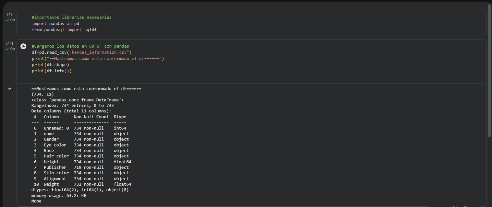

Como se puede ver en la imagen de Colab tenemos valores nulos en los siguientes campos:

- Publisher
- Weight      
  
2.- Propón un modelo relacional

Observando los datos 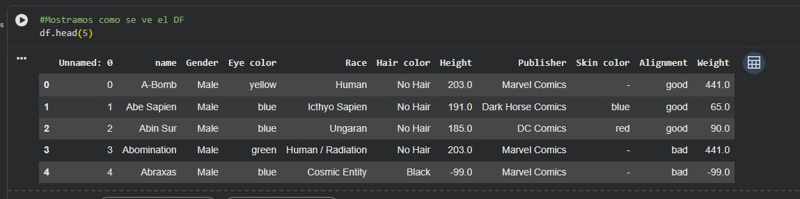
nos damos cuenta que el publisher se puede separar en una tabla y relacionarla por medio de un id, los campos describen los atributos fisicos de un héroe el publisher se puede sacar asi mismo la raza también se puede separar, del mismo modo se puede crear un catálogo de colores para usarlos en los campos que describan algun color, funcionarian como catálogos asi quedarian las tres tablas:

publisher Tabla de publicadores

|id|name|
| --- | --- |
|1|Marvel Comics|
|2|DC Comics|

race  Tabla de razas

|id|name|
| --- | --- |
|1|Human|
|2|Icthyo Sapien|

colors Tabla de colores para ojos y piel
|id|name|
| --- | --- |
|1|blue|
|2|yellow|

heroes

|Unnamed: 0|name|Gender|eye_color_id|race_id|Hair color|Heigth|publisher_id|skin_color_id|Alignment|Weight|
| --- | --- | --- | --- | --- | --- | --- | --- | --- | ---| ---|
|0|A-Bomb|Male|2|1|No Hair|203.0|1|null|good|441|
|7|Adam Strange|Male|1|1|Blond|185|2|null|good|61|


3.- Crea la estructura de la base de datos

Para cear la estructura del paso anterior usaré Mysql ejecutandose en un contenedor de Docker, me conectare a la base de datos por medio del progrma HeidiSql

Para la definición de los tamaños de los campos revisamos el df cargado el colab y sacamos los máximos de los campos object.

```python
    name :25
    Gender: 6
    Eye color: 23
    Race: 18
    Hair color: 16
    Publisher: 17.0
    Skin color: 14
    Alignment: 7
```

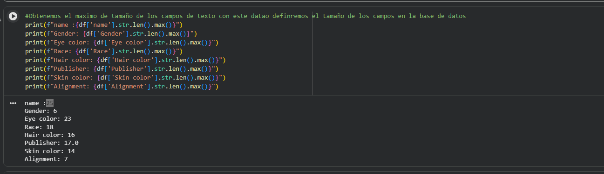


1. Cración de base de datos 
   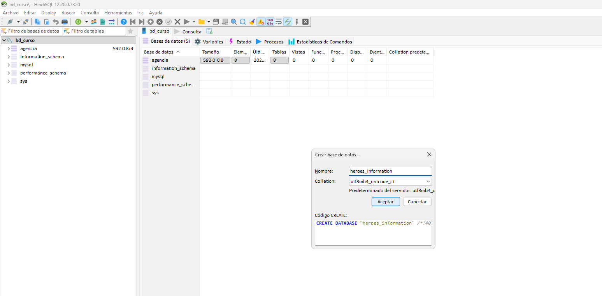

Creamos las tablas 

Estas son las consultas de creación de base de datos que se ejecutaron:

```sql
-- Catálogo para ojos y piel
CREATE TABLE colors (
    id INT NOT NULL AUTO_INCREMENT,
    name VARCHAR(23) NOT NULL,
    PRIMARY KEY (id)
);
-- Catálogo para publishers
CREATE TABLE publishers (
	id INT NOT NULL AUTO_INCREMENT COMMENT 'id de la tabla',
	name VARCHAR(17) NOT NULL DEFAULT '' COMMENT 'nombre del publicador',
	PRIMARY KEY (id) 
);
-- Catálogo para razas
CREATE TABLE race (
	id INT NOT NULL AUTO_INCREMENT COMMENT 'id de la tabla',
	name VARCHAR(18) NOT NULL DEFAULT '' COMMENT 'nombre de la raza',
	PRIMARY KEY (id)
);
-- tabla de heores nueva
CREATE TABLE heroes (
	id INT NOT NULL AUTO_INCREMENT COMMENT 'id de la tabla',
	name VARCHAR(25) NOT NULL COMMENT 'nombre del heroe',
	gender VARCHAR(6) NOT NULL COMMENT 'genero',
	eye_color_id INT NULL DEFAULT NULL COMMENT 'id de la tabla colors',
	race_id INT NULL DEFAULT NULL COMMENT 'id de la tabla race',
	hair_color VARCHAR(16) NOT NULL COMMENT 'color del cabello',
	height FLOAT NOT NULL DEFAULT '0' COMMENT 'altura',
	publisher_id INT NULL DEFAULT NULL COMMENT 'id de la tabla publishers',
	skin_color_id INT NULL DEFAULT NULL COMMENT 'id de la tabla colors',
	alignment VARCHAR(7) NOT NULL COMMENT 'alineancion',
	weight FLOAT NOT NULL DEFAULT '0' COMMENT 'peso',
	PRIMARY KEY (id),
   FOREIGN KEY (publisher_id) REFERENCES publishers(id),
   FOREIGN KEY (race_id) REFERENCES race(id),
   FOREIGN KEY (eye_color_id) REFERENCES colors(id),
   FOREIGN KEY (skin_color_id) REFERENCES colors(id)
);
```
Ejecución de las consultas
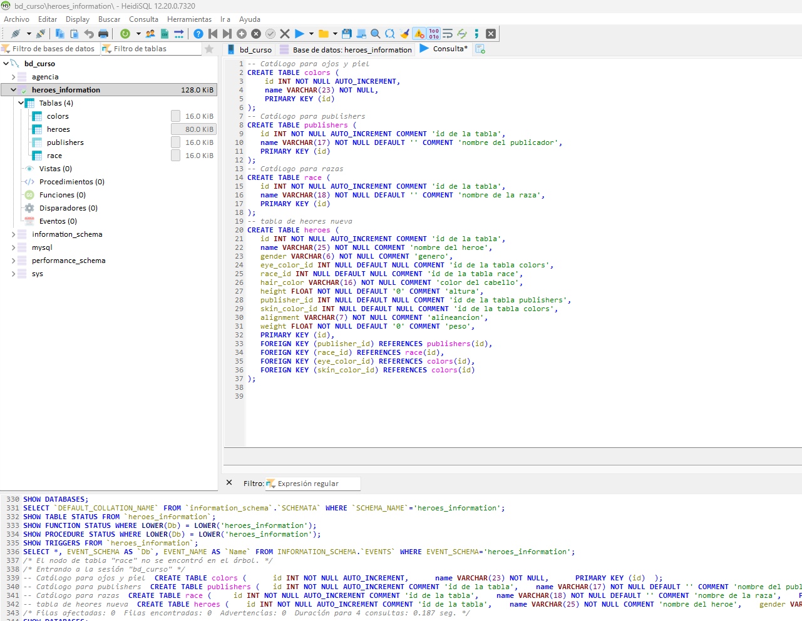


Aqui podemos ver las 4 tablas creadas

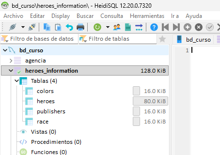


4. Inserta los primeros 20 registros
   
   para insertar los primeros 20 registros del CSV 
   tenemos que obtener primero los datos de las columnas colors, publishers y race.
   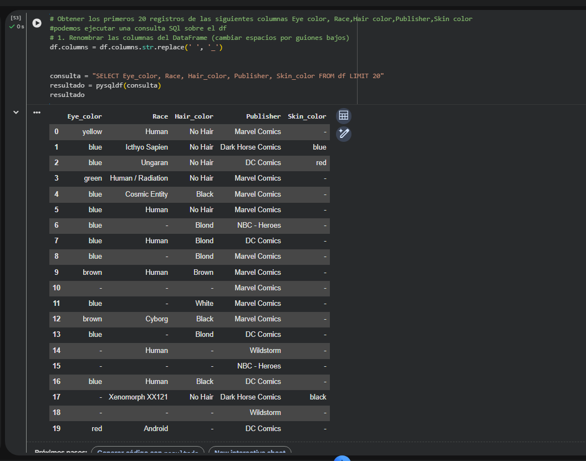

   Como los catálogos deben ser únicos vamos obtener los valores únicos de cada columna esos seran los que se insertaran manualmente en cada catálogo 
   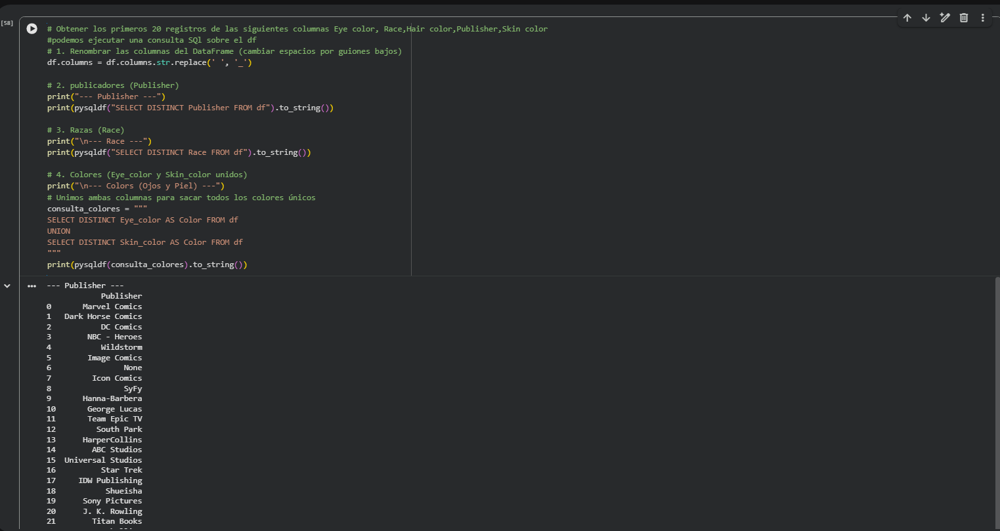

    * Se puede ver la salida completa en el link del Colab


Generamos los inserts con estos datos

```sql
INSERT INTO publishers (name) VALUES 
('Marvel Comics'), ('Dark Horse Comics'), ('DC Comics'), 
('NBC - Heroes'), ('Wildstorm'), ('Image Comics'), 
('Icon Comics'), ('SyFy'), ('Hanna-Barbera'), 
('George Lucas'), ('Team Epic TV'), ('South Park'), 
('HarperCollins'), ('ABC Studios'), ('Universal Studios'), 
('Star Trek'), ('IDW Publishing'), ('Shueisha'), 
('Sony Pictures'), ('J. K. Rowling'), ('Titan Books'), 
('Rebellion'), ('Microsoft'), ('J. R. R. Tolkien');

INSERT INTO race (name) VALUES 
('Human'), ('Icthyo Sapien'), ('Ungaran'), 
('Human / Radiation'), ('Cosmic Entity'), ('Cyborg'), 
('Xenomorph XX121'), ('Android'), ('Vampire'), 
('Mutant'), ('God / Eternal'), ('Symbiote'), 
('Atlantean'), ('Alien'), ('Neyaphem'), 
('New God'), ('Alpha'), ('Bizarro'), 
('Inhuman'), ('Metahuman'), ('Demon'), 
('Human / Clone'), ('Human-Kree'), ('Dathomirian Zabrak'), 
('Amazon'), ('Human / Cosmic'), ('Human / Altered'), 
('Kryptonian'), ('Kakarantharaian'), ('Zen-Whoberian'), 
('Strontian'), ('Kaiju'), ('Saiyan'), 
('Gorilla'), ('Rodian'), ('Flora Colossus'), 
('Human-Vuldarian'), ('Asgardian'), ('Demi-God'), 
('Eternal'), ('Gungan'), ('Bolovaxian'), 
('Animal'), ('Czarnian'), ('Martian'), 
('Spartoi'), ('Planet'), ('Luphomoid'), 
('Parademon'), ('Yautja'), ('Maiar'), 
('Clone'), ('Talokite'), ('Korugaran'), 
('Zombie'), ('Human-Vulcan'), ('Human-Spartoi'), 
('Tamaranean'), ('Frost Giant'), ('Mutant / Clone'), 
("Yoda's species");

INSERT INTO colors (name) VALUES 
('amber'), ('black'), ('blue'), ('blue / white'), 
('blue-white'), ('bown'), ('brown'), ('gold'), 
('gray'), ('green'), ('green / blue'), ('grey'), 
('hazel'), ('indigo'), ('orange'), ('orange / white'), 
('pink'), ('purple'), ('red'), ('red / black'), 
('silver'), ('violet'), ('white'), ('white / red'), 
('yellow'), ('yellow (without irises)'), ('yellow / blue'), 
('yellow / red');

```
Salida en Heidi
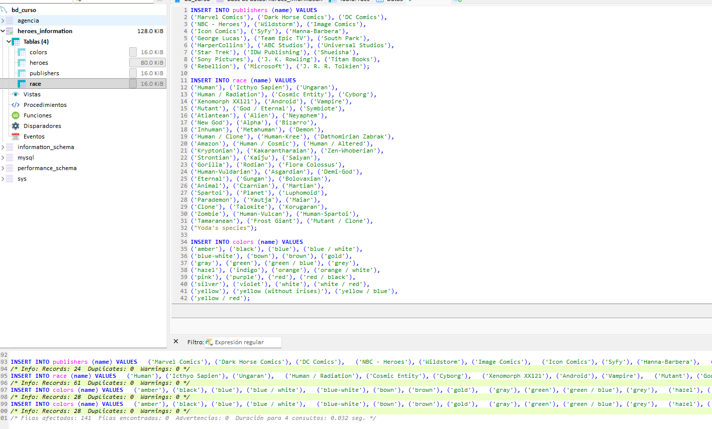


Ahora obtenemos los 20 primeros heroes 
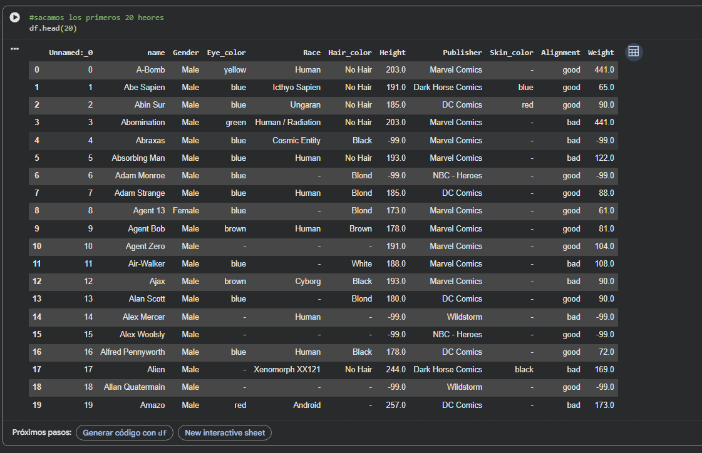


Este es el insert ya considerando los id de las tablas anteriores, catálogos les vamos a llamar, en este caso cuando tiene - sera un null 


```sql
INSERT INTO heroes (id, name, gender, eye_color_id, race_id, hair_color, height, publisher_id, skin_color_id, alignment, weight) 
VALUES 
(0, 'A-Bomb', 'Male', 25, 1, 'No Hair', 203.0, 1, NULL, 'good', 441.0),
(1, 'Abe Sapien', 'Male', 3, 2, 'No Hair', 191.0, 2, 3, 'good', 65.0),
(2, 'Abin Sur', 'Male', 3, 3, 'No Hair', 185.0, 3, 19, 'good', 90.0),
(3, 'Abomination', 'Male', 10, 4, 'No Hair', 203.0, 1, NULL, 'bad', 441.0),
(4, 'Abraxas', 'Male', 3, 5, 'Black', -99.0, 1, NULL, 'bad', -99.0),
(5, 'Absorbing Man', 'Male', 3, 1, 'No Hair', 193.0, 1, NULL, 'bad', 122.0),
(6, 'Adam Monroe', 'Male', 3, NULL, 'Blond', -99.0, 4, NULL, 'good', -99.0),
(7, 'Adam Strange', 'Male', 3, 1, 'Blond', 185.0, 3, NULL, 'good', 88.0),
(8, 'Agent 13', 'Female', 3, NULL, 'Blond', 173.0, 1, NULL, 'good', 61.0),
(9, 'Agent Bob', 'Male', 7, 1, 'Brown', 178.0, 1, NULL, 'good', 81.0),
(10, 'Agent Zero', 'Male', NULL, NULL, 'No Hair', 191.0, 1, NULL, 'good', 104.0),
(11, 'Air-Walker', 'Male', 3, NULL, 'White', 188.0, 1, NULL, 'bad', 108.0),
(12, 'Ajax', 'Male', 7, 6, 'Black', 193.0, 1, NULL, 'bad', 90.0),
(13, 'Alan Scott', 'Male', 3, NULL, 'Blond', 180.0, 3, NULL, 'good', 90.0),
(14, 'Alex Mercer', 'Male', NULL, 1, 'No Hair', -99.0, 5, NULL, 'bad', -99.0),
(15, 'Alex Woolsly', 'Male', NULL, NULL, 'No Hair', -99.0, 4, NULL, 'good', -99.0),
(16, 'Alfred Pennyworth', 'Male', 3, 1, 'Black', 178.0, 3, NULL, 'good', 72.0),
(17, 'Alien', 'Male', NULL, 7, 'No Hair', 244.0, 2, 2, 'bad', 169.0),
(18, 'Allan Quatermain', 'Male', NULL, NULL, 'No Hair', -99.0, 5, NULL, 'good', -99.0),
(19, 'Amazo', 'Male', 19, 8, 'No Hair', 257.0, 3, NULL, 'bad', 173.0);
```

Salida de la consulta

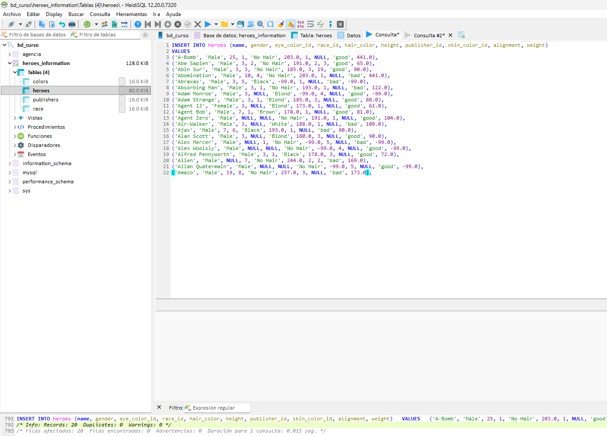


5. Modifica los valores incorrectos de la columna Weight
   
   Para modificar los valores vamos a ejecutar una consulta `UPDATE` 
   Reemplaza todos los valores -99.0 o -099.0 (según aparezca en los datos) por NULL, ya sea al insertar o con una instrucción UPDATE.

    1. Primero alteramos el campo para que acepte nulos
    ```sql 
    ALTER TABLE heroes
	CHANGE COLUMN weight weight FLOAT NULL DEFAULT NULL COMMENT 'peso' AFTER alignment;
    ```
    2. Actualizamos los valores 
    ```sql 
    UPDATE
     heroes
    SET
     heroes.weight=NULL
    WHERE
     heroes.weight=-99.0 OR heroes.weight=-099.0;

    ```

   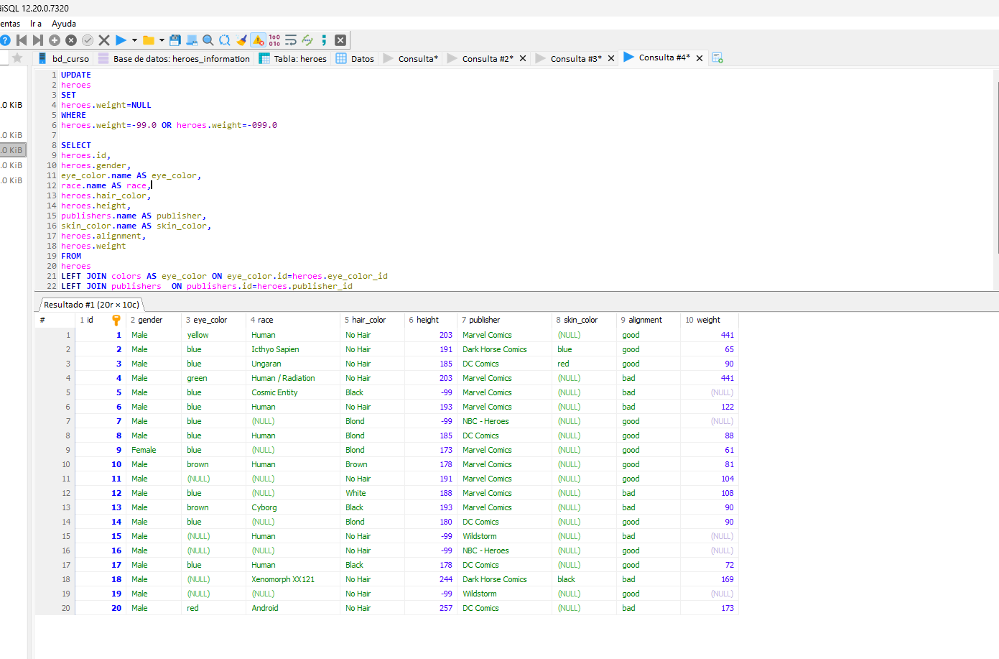

6. Recrea la información original con un Join 

Ejecutamos la consulta para obtener los 20 registros 

```sql
SELECT
heroes.id,
heroes.gender,
eye_color.name AS eye_color,
race.name AS race,
heroes.hair_color,
heroes.height,
publishers.name AS publisher, 
skin_color.name AS skin_color,
heroes.alignment,
heroes.weight
FROM
heroes
LEFT JOIN colors AS eye_color ON eye_color.id=heroes.eye_color_id
LEFT JOIN publishers  ON publishers.id=heroes.publisher_id
LEFT JOIN race  ON race.id=heroes.race_id
LEFT JOIN colors AS skin_color ON skin_color.id=heroes.skin_color_id
```

Salida de la consulta
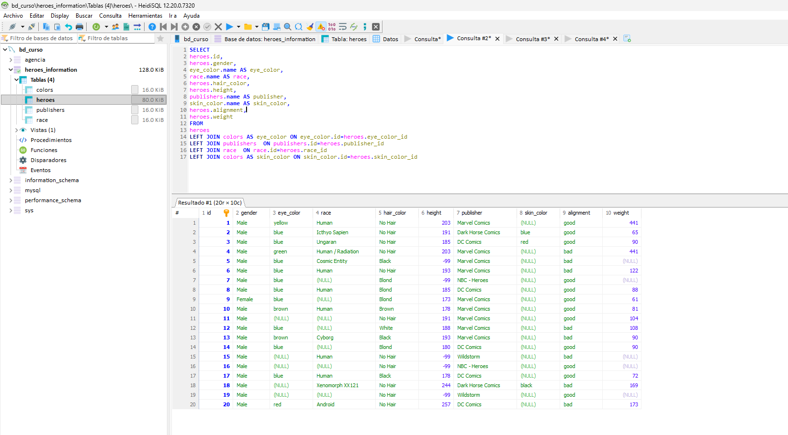

Creamos la vista 

```sql
CREATE OR REPLACE VIEW superheroe AS
SELECT
    heroes.id,
    heroes.gender,
    eye_color.name AS eye_color,
    race.name AS race,
    heroes.hair_color,
    heroes.height,
    publishers.name AS publisher, 
    skin_color.name AS skin_color,
    heroes.alignment,
    heroes.weight
FROM
    heroes
LEFT JOIN colors AS eye_color ON eye_color.id = heroes.eye_color_id
LEFT JOIN publishers ON publishers.id = heroes.publisher_id
LEFT JOIN race ON race.id = heroes.race_id
LEFT JOIN colors AS skin_color ON skin_color.id = heroes.skin_color_id;
``` 
Salida de la consulta
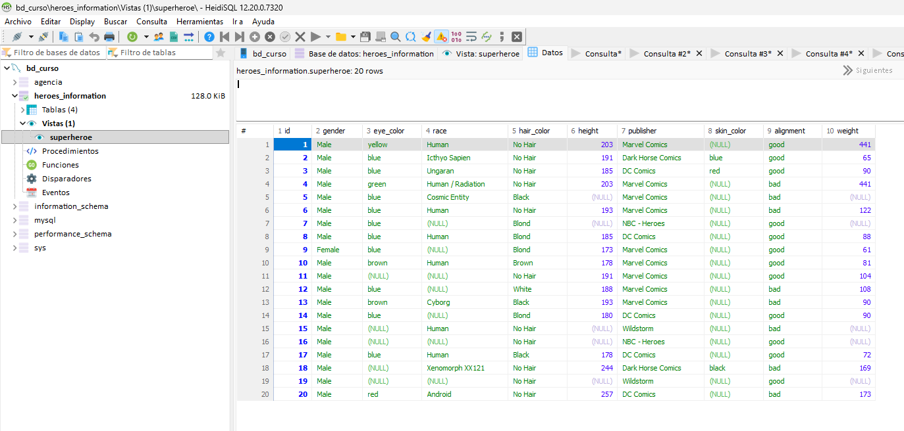

7. Consulta al superhéroe más alto

Escribe una consulta SQL para mostrar toda la información del superhéroe con mayor estatura (de los 20 registros que insertaste).

```sql
SELECT * 
FROM heroes 
WHERE height = (SELECT MAX(height) FROM heroes);
```
Salida de la consulta 
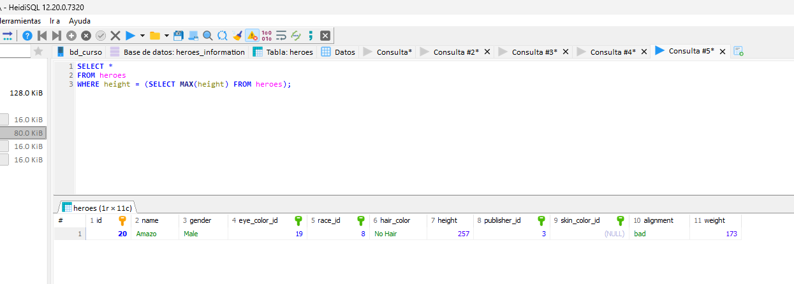

8. Consulta a los superhéroes con peso mayor al promedio

Escribe una consulta que obtenga los superhéroes cuyo peso sea mayor que el promedio general de todos los pesos registrados.

```sql
SELECT * 
FROM heroes 
WHERE weight > (SELECT AVG(weight) FROM heroes);
```
Salida de la consulta 
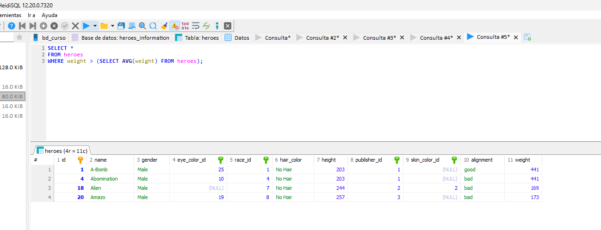

9. Consulta el promedio de estatura por editorial

Escribe una consulta que muestre el promedio de estatura de los superhéroes agrupados por editorial. Usa GROUP BY y AVG().

Para obtener la información correcta debemos actualizar los valores incorrectos de ese campo para eso corremos esta consulta

```sql
ALTER TABLE heroes
	CHANGE COLUMN height height FLOAT NULL DEFAULT NULL COMMENT 'altura' AFTER hair_color;

```

```sql
UPDATE
    heroes
SET
    heroes.height=NULL
WHERE
    heroes.height=-99.0 OR heroes.height=-099.0;
```

Con esto nos aseguramos que los cálculos de pueden hacer correctamente 

Esta es la consulta que ejecutaremos para sacar el promedio de estaturas

```sql
SELECT 
    publishers.name AS publisher,
    AVG(height) AS promedio_estatura
FROM heroes 
    LEFT JOIN publishers ON publishers.id=heroes.publisher_id
GROUP BY heroes.publisher_id
```
Salida de la consulta
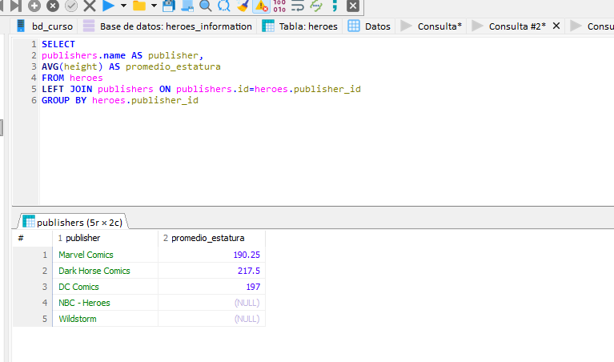

10. Reproduce la consulta anterior en Pandas usando pandaSQL

Carga el archivo CSV en una libreta de Python (.ipynb) usando Pandas. Emplea la librería pandaSQL para realizar una consulta que calcule el promedio de estatura por editorial.

Salida en Colab
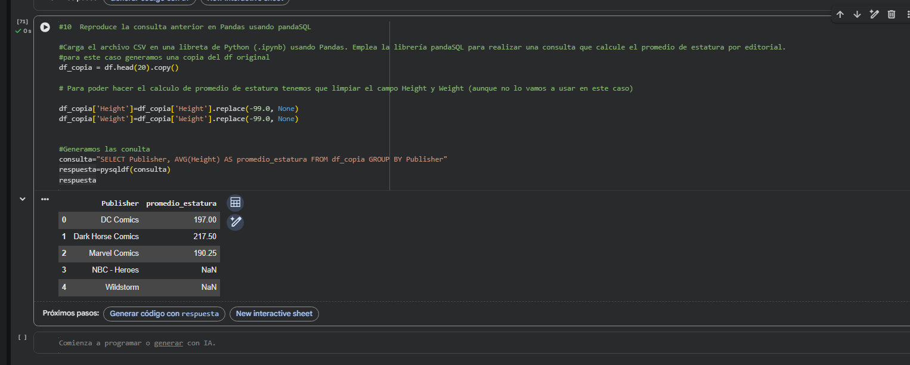