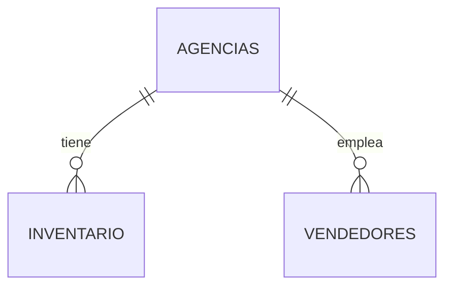

# Notas de manipulación de base de datos NO-SQL Mongo-db

Las bases de datos NoSQL no siguen un esquema predefinido y pueden estructurar la información de diversas maneras, motivo por el cual también se les conoce como bases de datos no estructuradas. 

Dentro de las bases de datos NoSQL existen diferentes subcategoria, como:

- Bases de tipo llave-valor: Almacenan información en pares clave-valor, similares a un diccionario.
  - Redis: Es uno de los mas popúlares, usado frecuentemente con caché y almacén de estructuras de datos en memoria
  - Amazon DynamoDB: Un servicio de base de datos completamente gestionado por AWS diseñado para alta escabilidad
  - Riak: Conicido por su alta disponibilidad y tolerancia a fallos en entornos distribuidos.  
- Bases de datos basadas en grafos: Representan datos meidnate nodos y relaciones, ideales para redes sociales o sistemas de recomendación
  - Neo4j:El lider del mercado para bases de datos de grafos, muy utulizado en deteccion de fraude y rdes sociales
  - Amazon Neptune: Servicio gestionado de AWS que soporta modelos de grafos de propiedad y RDF
  - FalkorDB: Una base deda tis de grafos construida sobre Redis, optimizada para consultas rápidas y eficientes en momeria.
- Bases de datos de documentos: Almacenan información en documentos, principalmente JSON o XML
  - MongoDB: El ejmplo mas claro de esta categoría; permite almacenar datos son un esquema fijo y es ampliamente usado en aplicaciones modernas
  - Couchbase: Combina al almacenamiento de documentos con capacidades de clave-valor y ofrece una alta escalabilidad.
  - Amazon DocumentDB: Un servicio de dase de datos de documentos compatible con MongoDB, gestionado por AWS.  
- Bases de datos de objetos: Manejan datos como objetos, mantenido relaciones entre ellos
  - db4o: Una base de datos de objetos de código abierto muy conocida por su facilidad de integracion con apliaciones Java y .NET
  - GemStone: Un sistema maduro y robusto pque ha sido utilizado en entornos empresariables de alta concurrencia.
  - InterSystems Cache: Aunque a veces se clasifica de forma híbrida, es un ejemplo de sistema que maneja datos como objetos y permite acceso relacional
- Bases de datos multimodelo: Combina múltiples enfoque en un mismos sitema.
  - ArangoDB: Soporta de forma nativa los modelos de documentos, grafos y clave-valor, utilizando su propio lenguaje de consulta unificado (AQL)
  - OrientDB: Es un sistema multimodelo que soporta grafos y documentos, y mantiene compatibilidad con SQL para facilitar la transación desde bases de datos relacionales.
  - Couchbase: Aunque se listó en documentos, también se considera multimodelos al integrar el acceso clave-valor con el almacenamiento de documentos.

# Fundamentos de MongoDB

Los datos de ejemplo son de agencias de autos en México y viven en tres colecciones. Los archivos están en la carpeta [`init/`](../../../init):

| Colección | Archivo | Documentos | Contenido |
| --- | --- | ---: | --- |
| `agencias` | [`agencias.json`](../../../init/agencias.json) | 50 | Datos de cada agencia: contacto, ubicación, horarios, servicios y marcas |
| `inventario` | [`inventario.json`](../../../init/inventario.json) | 458 | Vehículos a la venta. Cada uno pertenece a una agencia |
| `vendedores` | [`vehiculos.json`](../../../init/vehiculos.json) | 155 | Vendedores. Cada uno trabaja en una agencia |

El archivo `vehiculos.json` contiene los documentos de la colección `vendedores`, no vehículos. Los vehículos están en `inventario.json`.

La relación entre colecciones es una referencia: `inventario.id_agencia` y `vendedores.id_agencia` guardan el `_id` de la agencia. MongoDB no valida estas referencias, y se resuelven con `$lookup` (ver más abajo).



## Documento de `agencias`

Ya no incluye el arreglo `inventario`. Antes los vehículos iban incrustados en la agencia. Ahora están en su propia colección, porque una agencia puede tener decenas de vehículos y el documento crecería sin límite.

```json
{
  "_id": "agencia_001",
  "nombre": "AutoMax Premium",
  "tipo_agencia": "Concesionario Oficial",
  "marcas_autorizadas": ["Toyota", "Honda", "Mazda", "Volkswagen"],
  "contacto": {
    "telefono": "+52 55 1234 5678",
    "whatsapp": "+52 55 8765 4321",
    "email": "ventas@automaxpremium.com",
    "sitio_web": "www.automaxpremium.com",
    "redes_sociales": {
      "facebook": "/AutoMaxPremiumOficial",
      "instagram": "@automax_premium"
    }
  },
  "ubicacion": {
    "direccion": "Av. Insurgentes Sur 1450, Col. Actipan",
    "ciudad": "Ciudad de México",
    "estado": "CDMX",
    "codigo_postal": "03230",
    "coordenadas": {
      "latitud": 19.3715,
      "longitud": -99.1789
    }
  },
  "horarios_atencion": {
    "lunes_a_viernes": "09:00 - 19:00",
    "sabado": "10:00 - 16:00",
    "domingo": "Cerrado"
  },
  "servicios_ofrecidos": [
    "Venta de autos nuevos",
    "Financiamiento automotriz",
    "Seguro de auto",
    "Taller autorizado"
  ],
  "calificacion_clientes": 4.8,
  "fecha_apertura": "2015-03-15T00:00:00Z",
  "activa": true
}
```

## Documento de `inventario`

Un vehículo nuevo y uno seminuevo. Solo los seminuevos tienen `kilometraje`. `id_agencia` apunta a la agencia dueña del vehículo.

```json
{
  "_id": "VH-001",
  "id_agencia": "agencia_001",
  "marca": "Toyota",
  "modelo": "Corolla",
  "año": 2024,
  "precio_mxn": 415000.0,
  "estado": "Nuevo",
  "disponible": true
}
```

```json
{
  "_id": "VH-004",
  "id_agencia": "agencia_004",
  "marca": "Audi",
  "modelo": "A3",
  "año": 2022,
  "precio_mxn": 650000.0,
  "estado": "Seminuevo",
  "kilometraje": 15000,
  "disponible": true
}
```

| Campo | Valores |
| --- | --- |
| `estado` | `"Nuevo"` o `"Seminuevo"` |
| `disponible` | `false` cuando el vehículo ya está vendido o apartado |
| `año` | Año del modelo. Los nuevos son de 2023 a 2025 y los seminuevos de 2018 a 2023 |

## Documento de `vendedores`

```json
{
  "_id": "vendedor_01",
  "id_agencia": "agencia_001",
  "nombre": "Carlos Mendoza",
  "puesto": "Gerente de Ventas",
  "email": "carlos@automaxpremium.com"
}
```

## Cargar los datos en MongoDB

Con el contenedor `ds-mongo` en marcha (`docker compose up -d mongo`), ejecuta desde la raíz del proyecto. Cada comando usa `--drop`, así que reemplaza la colección si ya existe. Las credenciales se leen de las variables del contenedor.

```bash
for par in agencias:agencias inventario:inventario vehiculos:vendedores; do
  archivo=${par%%:*}; coleccion=${par##*:}
  docker exec -i ds-mongo sh -c "mongoimport -u \"\$MONGO_INITDB_ROOT_USERNAME\" -p \"\$MONGO_INITDB_ROOT_PASSWORD\" --authenticationDatabase admin --db ciencia_datos --collection $coleccion --drop --jsonArray" < init/$archivo.json
done
```

Para comprobar la carga:

```javascript
use ciencia_datos
db.agencias.countDocuments()    // 50
db.inventario.countDocuments()  // 458
db.vendedores.countDocuments()  // 155
```

# Búsquedas en MongoDB

Los ejemplos usan las colecciones `agencias`, `inventario` y `vendedores` descritas arriba. Se escriben para `mongosh`. Al final hay un ejemplo equivalente en Python con `pymongo`.

Para abrir `mongosh` en el contenedor del proyecto:

```bash
docker exec -it ds-mongo mongosh -u <MONGO_USER> -p --authenticationDatabase admin
```

## Estructura de una consulta

`find(filtro, proyeccion)` recibe dos documentos. El primero filtra qué documentos regresan y el segundo elige qué campos se muestran.

```javascript
use ciencia_datos

// Todos los documentos
db.agencias.find()

// Un solo documento (regresa el primero que coincida)
db.agencias.findOne({ nombre: "AutoMax Premium" })

// Igualdad simple
db.agencias.find({ activa: true })

// Varios campos en el filtro equivalen a un AND implícito
db.agencias.find({ activa: true, tipo_agencia: "Concesionario Oficial" })
```

### Proyección, orden y límite

```javascript
// 1 incluye el campo, 0 lo excluye. _id se incluye siempre salvo que se excluya
db.agencias.find({ activa: true }, { nombre: 1, "ubicacion.ciudad": 1, _id: 0 })

// Ordenar: 1 ascendente, -1 descendente
db.agencias.find().sort({ calificacion_clientes: -1 })

// Paginación
db.agencias.find().sort({ nombre: 1 }).skip(10).limit(5)

// Contar
db.agencias.countDocuments({ activa: true })
```

No se pueden mezclar inclusiones y exclusiones en la misma proyección. La única excepción es `_id: 0`.

## Acceso a campos anidados y arreglos

Para entrar a un subdocumento se usa la notación de punto y el nombre del campo entre comillas.

```javascript
db.agencias.find({ "ubicacion.estado": "CDMX" })
db.agencias.find({ "contacto.redes_sociales.instagram": "@automax_premium" })

// En un arreglo de valores simples, la igualdad busca si el valor está en el arreglo
db.agencias.find({ marcas_autorizadas: "Toyota" })

// Los vehículos están en otra colección, así que se filtran directamente
db.inventario.find({ marca: "Honda" })

// Los vehículos de una agencia se buscan por la referencia
db.inventario.find({ id_agencia: "agencia_001" })
```

Si un documento tuviera un arreglo de subdocumentos, la notación de punto buscaría en cualquiera de sus elementos (por ejemplo, `"inventario.marca"` cuando los vehículos van incrustados). En este modelo no hace falta, porque cada vehículo es un documento propio.

## Operadores de comparación

Los operadores empiezan con `$` y se escriben dentro del campo que se compara: `{ campo: { $operador: valor } }`.

| Operador | Significado | Equivalente SQL |
| --- | --- | --- |
| `$eq` | Igual a | `=` |
| `$ne` | Distinto de | `<>` o `!=` |
| `$gt` | Mayor que | `>` |
| `$gte` | Mayor o igual que | `>=` |
| `$lt` | Menor que | `<` |
| `$lte` | Menor o igual que | `<=` |
| `$in` | Igual a cualquiera de los valores de una lista | `IN` |
| `$nin` | No es igual a ninguno de los valores de la lista | `NOT IN` |

```javascript
// Calificación de 4.5 o más
db.agencias.find({ calificacion_clientes: { $gte: 4.5 } })

// Rango: se combinan dos operadores sobre el mismo campo (BETWEEN)
db.agencias.find({ calificacion_clientes: { $gte: 4, $lt: 5 } })

// Distinto de
db.agencias.find({ tipo_agencia: { $ne: "Concesionario Oficial" } })

// Lista de valores
db.agencias.find({ "ubicacion.estado": { $in: ["CDMX", "Jalisco", "Nuevo León"] } })
db.agencias.find({ "ubicacion.estado": { $nin: ["CDMX"] } })

// Fechas: se comparan con objetos Date (en el ejemplo se guardó como texto ISO)
db.agencias.find({ fecha_apertura: { $lt: ISODate("2020-01-01T00:00:00Z") } })
```

`$ne` y `$nin` también regresan los documentos que no tienen el campo. Si no quieres eso, agrega `$exists: true`.

Comparar texto con `$gt` o `$lt` usa el orden alfabético. Las fechas guardadas como cadena ISO 8601 se ordenan bien, pero es mejor guardarlas como `Date`.

## Operadores lógicos

| Operador | Uso |
| --- | --- |
| `$and` | Todas las condiciones deben cumplirse |
| `$or` | Al menos una condición debe cumplirse |
| `$nor` | Ninguna condición debe cumplirse |
| `$not` | Niega el operador de un campo |

```javascript
// OR
db.agencias.find({
  $or: [
    { "ubicacion.estado": "CDMX" },
    { calificacion_clientes: { $gte: 4.8 } }
  ]
})

// AND explícito. Se usa cuando se repite el mismo campo o se combina con $or
db.agencias.find({
  $and: [
    { activa: true },
    { $or: [{ "ubicacion.estado": "CDMX" }, { "ubicacion.estado": "Jalisco" }] }
  ]
})

// NOT
db.agencias.find({ calificacion_clientes: { $not: { $gte: 4.5 } } })
```

## Operadores de elemento

```javascript
// El campo existe
db.agencias.find({ "contacto.whatsapp": { $exists: true } })

// El campo no existe
db.agencias.find({ "contacto.fax": { $exists: false } })

// Tipo de dato BSON
db.agencias.find({ calificacion_clientes: { $type: "double" } })

// Valor nulo
db.agencias.find({ "contacto.fax": null })
```

`{ campo: null }` coincide con valores nulos y con documentos que no tienen el campo.

## Operadores para arreglos

| Operador | Uso |
| --- | --- |
| `$all` | El arreglo contiene todos los valores indicados, sin importar el orden |
| `$size` | El arreglo tiene exactamente esa longitud |
| `$elemMatch` | Un mismo elemento cumple varias condiciones a la vez |

```javascript
// Vende Toyota y Honda
db.agencias.find({ marcas_autorizadas: { $all: ["Toyota", "Honda"] } })

// Exactamente 4 marcas
db.agencias.find({ marcas_autorizadas: { $size: 4 } })

// Agencias que venden Toyota o Honda (alguna de las dos)
db.agencias.find({ marcas_autorizadas: { $in: ["Toyota", "Honda"] } })
```

`$elemMatch` sirve cuando un arreglo contiene subdocumentos y varias condiciones deben cumplirse en el **mismo** elemento. Como los vehículos están en su propia colección, un vehículo que sea Honda y cueste menos de 600,000 se busca con un `find` normal, porque cada documento es un solo vehículo:

```javascript
db.inventario.find({ marca: "Honda", precio_mxn: { $lt: 600000 } })
```

`$elemMatch` vuelve a ser necesario después de un `$lookup`, que deja los vehículos de cada agencia en un arreglo. Ver "Relacionar colecciones con `$lookup`".

## Búsqueda de texto

### Expresiones regulares

`$regex` busca patrones dentro de una cadena. Es el equivalente de `LIKE` en SQL.

```javascript
// Empieza con "Auto" (equivale a LIKE 'Auto%')
db.agencias.find({ nombre: { $regex: "^Auto" } })

// Contiene "premium", sin distinguir mayúsculas (LIKE '%premium%')
db.agencias.find({ nombre: { $regex: "premium", $options: "i" } })

// Termina en "Oficial"
db.agencias.find({ tipo_agencia: { $regex: "Oficial$" } })

// Sintaxis corta con literal de expresión regular
db.agencias.find({ nombre: /premium/i })
```

| Opción | Efecto |
| --- | --- |
| `i` | No distingue mayúsculas de minúsculas |
| `m` | `^` y `$` coinciden en cada línea |
| `s` | El punto también coincide con saltos de línea |
| `x` | Ignora espacios en blanco del patrón |

Una expresión regular que empieza con `^` puede usar un índice sobre el campo. Las que empiezan con un comodín o usan `i` recorren la colección completa.

### Índice de texto y `$text`

Para buscar palabras en varios campos con relevancia, se crea un índice de texto. Cada colección admite solo uno.

```javascript
db.agencias.createIndex(
  { nombre: "text", servicios_ofrecidos: "text" },
  { default_language: "spanish" }
)

// Busca cualquiera de las palabras
db.agencias.find({ $text: { $search: "financiamiento seguro" } })

// Frase exacta
db.agencias.find({ $text: { $search: "\"taller de servicio\"" } })

// Excluir una palabra con el signo menos
db.agencias.find({ $text: { $search: "autos -seminuevos" } })

// Ordenar por relevancia
db.agencias.find(
  { $text: { $search: "financiamiento" } },
  { nombre: 1, puntaje: { $meta: "textScore" } }
).sort({ puntaje: { $meta: "textScore" } })
```

`$text` busca por palabra completa y aplica reglas del idioma, como quitar plurales. No sirve para buscar fragmentos dentro de una palabra. Para eso se usa `$regex`.

## Operadores de evaluación

```javascript
// $expr compara campos del mismo documento
db.agencias.find({ $expr: { $gt: ["$calificacion_clientes", 4.5] } })

// $mod: residuo de una división
db.inventario.find({ "año": { $mod: [2, 0] } })
```

## Orden de las condiciones y rendimiento

- Crea índices en los campos que más filtras: `db.agencias.createIndex({ "ubicacion.estado": 1 })`.
- Indexa los campos de referencia que usas para unir colecciones: `db.inventario.createIndex({ id_agencia: 1 })`. Sin ese índice, cada `$lookup` recorre toda la colección `inventario`.
- Usa `explain("executionStats")` para saber si una consulta usó un índice o recorrió toda la colección.
- Proyecta solo los campos que necesitas.

```javascript
db.agencias.find({ "ubicacion.estado": "CDMX" }).explain("executionStats")
```

## Agregación básica

El pipeline de agregación procesa los documentos por etapas. `$match` filtra con los mismos operadores de `find`, y las demás etapas transforman el resultado.

```javascript
// Precio promedio de los vehículos disponibles por marca
db.inventario.aggregate([
  { $match: { disponible: true } },
  { $group: { _id: "$marca", precio_promedio: { $avg: "$precio_mxn" }, total: { $sum: 1 } } },
  { $sort: { precio_promedio: -1 } }
])
```

| Etapa | Función |
| --- | --- |
| `$match` | Filtra documentos |
| `$unwind` | Convierte cada elemento de un arreglo en un documento |
| `$group` | Agrupa y calcula con `$sum`, `$avg`, `$min`, `$max` |
| `$project` | Elige o calcula campos |
| `$sort`, `$limit` | Ordenan y limitan el resultado |
| `$lookup` | Une documentos de otra colección (equivale a un `LEFT JOIN`) |

## Relacionar colecciones con `$lookup`

`$lookup` busca, para cada documento, los documentos de otra colección cuyo campo coincide, y los deja en un arreglo nuevo. Los parámetros son `from` (colección a unir), `localField` (campo de la colección actual), `foreignField` (campo de la otra colección) y `as` (nombre del arreglo resultante).

```javascript
// Cada agencia con sus vehículos
db.agencias.aggregate([
  { $lookup: { from: "inventario", localField: "_id", foreignField: "id_agencia", as: "vehiculos" } },
  { $project: { nombre: 1, "ubicacion.ciudad": 1, vehiculos: 1 } }
])

// Número de vehículos disponibles por agencia, de mayor a menor
db.agencias.aggregate([
  { $lookup: { from: "inventario", localField: "_id", foreignField: "id_agencia", as: "vehiculos" } },
  { $project: {
      nombre: 1,
      disponibles: { $size: { $filter: { input: "$vehiculos", cond: "$$this.disponible" } } }
  } },
  { $sort: { disponibles: -1 } }
])

// Agencias con al menos un Honda de menos de 600,000: aquí sí se usa $elemMatch
db.agencias.aggregate([
  { $lookup: { from: "inventario", localField: "_id", foreignField: "id_agencia", as: "vehiculos" } },
  { $match: { vehiculos: { $elemMatch: { marca: "Honda", precio_mxn: { $lt: 600000 } } } } },
  { $project: { nombre: 1, _id: 0 } }
])

// Desde el otro lado: cada vehículo con los datos de su agencia
db.inventario.aggregate([
  { $match: { estado: "Seminuevo", disponible: true } },
  { $lookup: { from: "agencias", localField: "id_agencia", foreignField: "_id", as: "agencia" } },
  { $unwind: "$agencia" },
  { $project: { marca: 1, modelo: 1, precio_mxn: 1, "agencia.nombre": 1, "agencia.ubicacion.ciudad": 1, _id: 0 } }
])

// Vendedores de las agencias de un estado
db.vendedores.aggregate([
  { $lookup: { from: "agencias", localField: "id_agencia", foreignField: "_id", as: "agencia" } },
  { $unwind: "$agencia" },
  { $match: { "agencia.ubicacion.estado": "Jalisco" } },
  { $project: { nombre: 1, puesto: 1, "agencia.nombre": 1, _id: 0 } }
])
```

`$unwind` después de un `$lookup` convierte el arreglo de un solo elemento en un subdocumento, y descarta las agencias o vehículos sin coincidencia. Para conservarlos, usa `{ $unwind: { path: "$agencia", preserveNullAndEmptyArrays: true } }`.

## Equivalencia SQL y MongoDB

| SQL | MongoDB |
| --- | --- |
| `SELECT * FROM agencias` | `db.agencias.find()` |
| `WHERE activa = 1` | `find({ activa: true })` |
| `WHERE calificacion >= 4.5` | `find({ calificacion_clientes: { $gte: 4.5 } })` |
| `WHERE estado IN ('CDMX', 'Jalisco')` | `find({ "ubicacion.estado": { $in: [...] } })` |
| `WHERE a AND b` | `find({ a: ..., b: ... })` |
| `WHERE a OR b` | `find({ $or: [{ a: ... }, { b: ... }] })` |
| `WHERE nombre LIKE '%premium%'` | `find({ nombre: /premium/i })` |
| `ORDER BY x DESC LIMIT 5` | `find().sort({ x: -1 }).limit(5)` |
| `COUNT(*)` | `countDocuments()` |
| `GROUP BY` | `aggregate([{ $group: ... }])` |
| `FROM inventario i LEFT JOIN agencias a ON a._id = i.id_agencia` | `db.inventario.aggregate([{ $lookup: { from: "agencias", localField: "id_agencia", foreignField: "_id", as: "agencia" } }])` |

## Las mismas consultas desde Python

`pymongo` usa diccionarios con la misma estructura que `mongosh`. Las diferencias son que `true`, `false` y `null` se escriben `True`, `False` y `None`, y que los métodos usan guion bajo (`sort`, `limit`).

```python
import os
import re
from dotenv import load_dotenv, find_dotenv
from pymongo import MongoClient, DESCENDING

load_dotenv(find_dotenv(), override=True)

client = MongoClient(
    host=os.getenv("MONGO_HOST", "127.0.0.1"),
    port=int(os.getenv("MONGO_PORT", "27017")),
    username=os.environ["MONGO_USER"],
    password=os.environ["MONGO_PASSWORD"],
    authSource="admin",
)
db = client["ciencia_datos"]
agencias = db["agencias"]
inventario = db["inventario"]
vendedores = db["vendedores"]

# Comparación
for doc in agencias.find({"calificacion_clientes": {"$gte": 4.5}}, {"nombre": 1, "_id": 0}):
    print(doc)

# Lógico y lista de valores
filtro = {
    "$or": [
        {"ubicacion.estado": {"$in": ["CDMX", "Jalisco"]}},
        {"calificacion_clientes": {"$gte": 4.8}},
    ]
}
resultado = agencias.find(filtro).sort("calificacion_clientes", DESCENDING).limit(5)

# Expresión regular sin distinguir mayúsculas
agencias.find({"nombre": {"$regex": "premium", "$options": "i"}})
agencias.find({"nombre": re.compile("premium", re.IGNORECASE)})

# Vehículos de una agencia que cumplen varias condiciones
inventario.find({"id_agencia": "agencia_001", "marca": "Honda", "precio_mxn": {"$lt": 600000}})

# Conteo y agregación
agencias.count_documents({"activa": True})
inventario.aggregate([
    {"$match": {"disponible": True}},
    {"$group": {"_id": "$marca", "promedio": {"$avg": "$precio_mxn"}}},
    {"$sort": {"promedio": -1}},
])

# Unir colecciones: cada agencia con sus vehículos
agencias.aggregate([
    {"$lookup": {"from": "inventario", "localField": "_id", "foreignField": "id_agencia", "as": "vehiculos"}},
    {"$project": {"nombre": 1, "total_vehiculos": {"$size": "$vehiculos"}}},
])

# Vendedores con los datos de su agencia
vendedores.aggregate([
    {"$lookup": {"from": "agencias", "localField": "id_agencia", "foreignField": "_id", "as": "agencia"}},
    {"$unwind": "$agencia"},
    {"$project": {"nombre": 1, "puesto": 1, "agencia": "$agencia.nombre", "_id": 0}},
])
```
